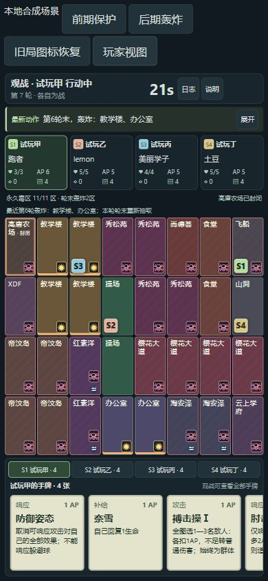

# 试玩补丁完成与验证记录

日期：2026-10-17。候选0.2.3-p2.4 / web-v0.1.5 / schema2 / engineRevision14。规则来自负责人本会话直接提出的五项补丁、随后确认的三组参数，以及跑者AP高于6不重置的最终更正。

## 本轮已实现

1. 轰炸标记消失：原来轮末选出轰炸区，下一轮刷新立即清空。新版保留最近一次地区和轰炸轮次；玩家／观战显示“最近第N轮”记录，不当作预告。旧v0.1.4已清空快照可从公开环境日志恢复显示，不修改旧局伤害。
2. 每局先手：可信数据库房间开始入口显式独立抽取S1—S4，客户端不能传first。实际48次安全随机开局覆盖四个座位。旧引擎本来已有随机分支，本轮未声称复现了所有线上“S2固定”的原因；新入口消除对初始化随机消费位置的依赖，重复请求不重抽。
3. 三地保护：教学楼／操场／办公室永久不进毒圈；山洞仍完全不进毒圈／轰炸。其余11区每轮新增2个毒区；全部中毒后，上述3地加入原5个室外轰炸候选，合计8区。
4. 野人：按每人自己的个人回合结束计数，连续第3、6、9次各扣最多2AP、受1可护盾伤害；离洞立即清零。超时、重连、手牌上限、受伤技能和淘汰接入真实队列，不计玩家击杀。
5. 躲避球：新版不提供防御姿态响应，服务器拒绝伪造选择；卡牌界面说明同步。其他攻击及旧规则响应行为保留。
6. 跑者：不参加整轮统一AP增加；个人回合AP不足6才补到6，已有6及以上保持原值，之后仍结算尚德荟加成。角色说明和TS／SQL均同步。

负责人同时批准角色建议稿，最新梅梅涛规则已实现为TS／SQL效果边界：当前效果与其他角色技能有关时整份无效，不追溯历史摸牌来源；阵营名单工具落实Q1。**这只是角色引擎基础，梅梅涛及完整16角色尚未进入真实可玩池，选角房间流程尚未启用。** 现有可玩池仍4角色、12种64实体牌。

## 验证证据

- 全量36个测试文件，293项通过、0失败，见[完整报告](../artifacts/p2-feedback-patch/test-results.json)。相比此前271项，新增22项覆盖补丁、角色免疫边界、界面与升级。
- 最后界面布局修正后，4项界面专项再次通过，见[界面复验](../artifacts/p2-feedback-patch/ui-final-tests.json)；就绪检查加强后，12项补丁／迁移专项再次通过，见[SQL复验](../artifacts/p2-feedback-patch/final-sql-tests.json)。
- TS／SQL完整开局及逐步命令状态一致；毒区耗尽和轰炸候选开启边界；野人第三／第六次、AP不足、护盾、离洞、超时；跑者低AP／6AP／9AP及尚德荟顺序；原规则继续原行为。
- 014单语句迁移故意失败全部回滚，重复执行保留旧房间／目录／凭据／回执；鉴权开局、重复命令、首位注入拒绝及私有ACL通过。删除新版必要数据不能虚报ready。
- `npm run build`含类型检查通过；`verify:catalog`、`verify:db-data`、`verify:data`、`verify:classic-map`通过。012和013字节哈希保持原值。
- 浏览器使用真实OnlineBoard／SpectatorBoard与本地合成状态，不接云库。360／390手机与1200桌面检查前期保护、后期轰炸、旧局记录恢复、观战显示。390下页面／棋盘不越界；手牌高度与内容高度均121，可横向滑动，滚动条隐藏；应用控制台无警告／错误，详见[浏览器记录](../artifacts/p2-feedback-patch/browser-validation.json)。
- 实测发现新增历史说明的最小宽度会撑开手机棋盘，以及观战页单独历史行误占伸缩布局，两项均修正。原恢复测试曾假定一小时必终局；新保护区允许更长存活，测试改用可预测的岛上占位验证原期限追赶与自然终局，产品没有恢复12轮强制结束。

## 部署边界

014安装在完整012之后，013选角基础不是前置要求。已有库必须保留快照并用增量升级，不重跑000—004、不清库；v0.1.1—v0.1.4保存对局保持原版，新局用v0.1.5。新应用ready要求引擎14、规则v0.1.5及classicPatchReady等就绪标记。

负责人另要求交付WorkBuddy部署包；以本轮发布目录的源码／SQL manifest、校验值和独立解压验证报告为准。此前0.2.2-p2.3阶段二包全部SHA-256未变，也不包含这些补丁。**未执行云端SQL、部署、GitHub推送或真人验收。**

