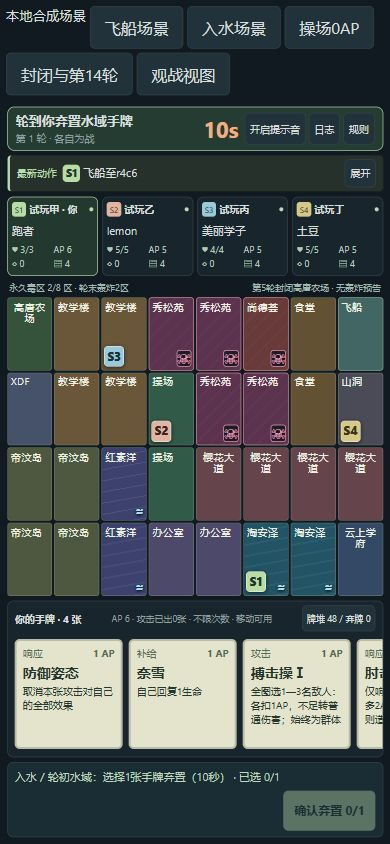
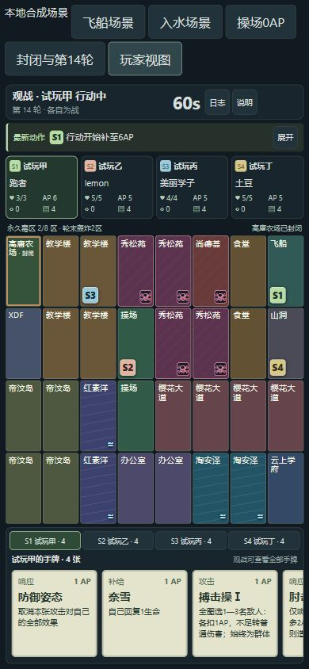

# 阶段2完成记录：经典地图、地点、水域与环境

日期：2026-10-17，Asia/Hong_Kong。负责人先批准阶段2及地点参数，随后在问题复述后回复“全部同意”，确认水域及环境建议全部采用，毒区固定每整轮新增2个。规则全文见[web-v0.1.4](web-rules-v0.1.4.md)。

**本地开发与验证完成；当前候选0.2.2-p2.3 / web-v0.1.4 / schema2 / engineRevision12。尚未提交、推送、生成本版完整源码ZIP、操作WorkBuddy云库或部署；本报告不代表真人验收。**

## 已交付的行为

- 经典4×8地图、固定出生地区内随机空格；lemon是帝汶家族随从，水生，操场出生／所述复活地点。未增加复活能力或“半个”数值折扣。
- 农场补牌、操场免费移动、尚德荟AP、XDF治疗优先级、教学楼／秀松苑使用禁令、办公室效果免疫、山洞停止／占位规则接入真实TS／SQL流程。
- 新增飞船／通校意图与落点界面，数据库检查本人行动阶段、AP门槛、空位、次数及农场封闭；不改变基础移动次数、不刷新行动时间。
- 入水、连续水段、再入水、无牌、水生免弃、10秒自选／超时弃最小实体ID；选择窗口及待续路径保存在权威状态内，可恢复、重复请求只执行一次。
- 水生直线越水1步，对岸占位时只给合法相邻空陆地；水域普通耗2步，山洞占用不可穿过。
- 整轮初水域弃牌→AP补充→毒区刷新；从第1轮新增2个永久室内毒区，耗尽不再抽。轮末抽2个不同室外地区统一结算环境，护盾生效，连续实际失血翻倍，换区／全挡／未伤重置。第5轮农场封闭，原住可留／离开，仍可轰炸。
- 新版无12轮强制终局；旧三个版本保留原行为。候选新开联机局使用v0.1.4，原局不重建、不改房间码／成员。仍是已实现4角色、12种64实体牌；三选一、新增角色、全牌池／装备和新牌强制移动在后续阶段。

## 代码与权限

规则拆为`packages/game-core/src/classic.ts`、`locations.ts`及主状态机，客户端和协议加入`location`意图与`water-discard`选择。随机、合法性、费用、计时、伤害、胜负仍由PostgreSQL事务执行，客户端不提交Setup、骰子或完整状态。

新增`database/migrations/012_classic_rules.sql`，源为`database/engine/classic.sql`和`tools/generate-classic-engine.mjs`。012更新经典profile和版本分支；三个旧profile及现有房间行不改。011的profile另存冻结基线JSON，010与011字节哈希不变；原始卡牌转录和图片未改。

沿用5个公开RPC，不增加管理员接口。`ml_room`只扩充游戏意图，保留凭据／epoch／matchId／revision／回执检查。私有函数对public／anon／authenticated撤权。健康检查要求规则v0.1.4、引擎≥12及经典数据／地点／水域／环境就绪标记；删除关键classic traits时不报告就绪。

## 实际执行的验证

报告：`artifacts/p2-stage2/test-results.json`，摘要和迁移SHA-256：`artifacts/p2-stage2/summary.json`。

- 全量 **29个测试文件，254项通过、0失败**；包含旧版、FFA／2v2、Socket.IO长轮询、私密视图、聊天、观战、重连、持久化及超时回归。
- 经典完整开局、每个命令及恢复后的完整状态TS／SQL对照；固定16角色目录的全部1820种四人出生组合仍合法，实际可玩池没有提前扩到16角色。
- 10秒水域超时、连续水段／再入水、空手、lemon越水、飞船入水、通校耗尽AP、非法／重复操作、占用水格超时返回、非法路径尾部原子拒绝。
- 真实轮末护盾抵挡、伤后技能、同批队伍淘汰与自然胜负；毒区耗尽、连续伤害重置、封闭农场及第14轮仍可继续。
- 012单条DO安装故意失败完整回滚、重复安装；旧房间／三个旧profile完全不变，原凭据、epoch与回执可用；旧局结束后同房间开经典局；新地点请求经匿名鉴权RPC成功，重试只执行一次，接管重连保留原水域窗口；私有接口拒绝直调。
- `npm run build`（含类型检查）、`verify:catalog`、`verify:db-data`、`verify:data`及`verify:classic-map`通过。187张图片、4份原始牌面文档SHA-256不变；经典CSV逐格一致。
- 浏览器使用真实OnlineBoard／SpectatorBoard组件与TS合成场景，不连接云数据库。390px已操作飞船→水域→自选弃1→恢复行动、0AP操场移动、第14轮与封闭农场观战。360px下页面宽360、无横向溢出；手牌区宽345／内容464，可横向滚动；容器高度与scrollHeight均121，每张牌clientHeight／scrollHeight均106，竖向完整；页面和手牌scrollbar-width均none。控制台无错误。

## 发现与修复

首次全量测试中，沙箱拒绝127.0.0.1网络访问，相关网关测试因此失败；在获准的本机测试权限下重跑通过。另发现迁移生成器误取002的旧end_turn，导致v0.1.2走后结束漏扣AP；已改为读取所有此前补丁的最新函数定义，旧版回归重新通过。SQL字段歧义、源码CRLF归一化和一项测试生命上限写错也已修正。

另补整条移动路径预检：带非法尾部的请求在保存水域窗口前整体拒绝，避免之后无法恢复。无限轮次的长时间追赶采用有界分批推进，可继续追赶，不用12轮上限截断新版对局。

早期仅内部地点函数的239项历史记录见[p2-stage2-locations-validation.md](p2-stage2-locations-validation.md)与`location-internal-summary.json`，不作为当前功能限制。后续部署步骤见[WorkBuddy交接](p2-third-batch-workbuddy.md)；先完成同一提交的源码／SQL包再部署，当前旧ZIP不能代替本版。
