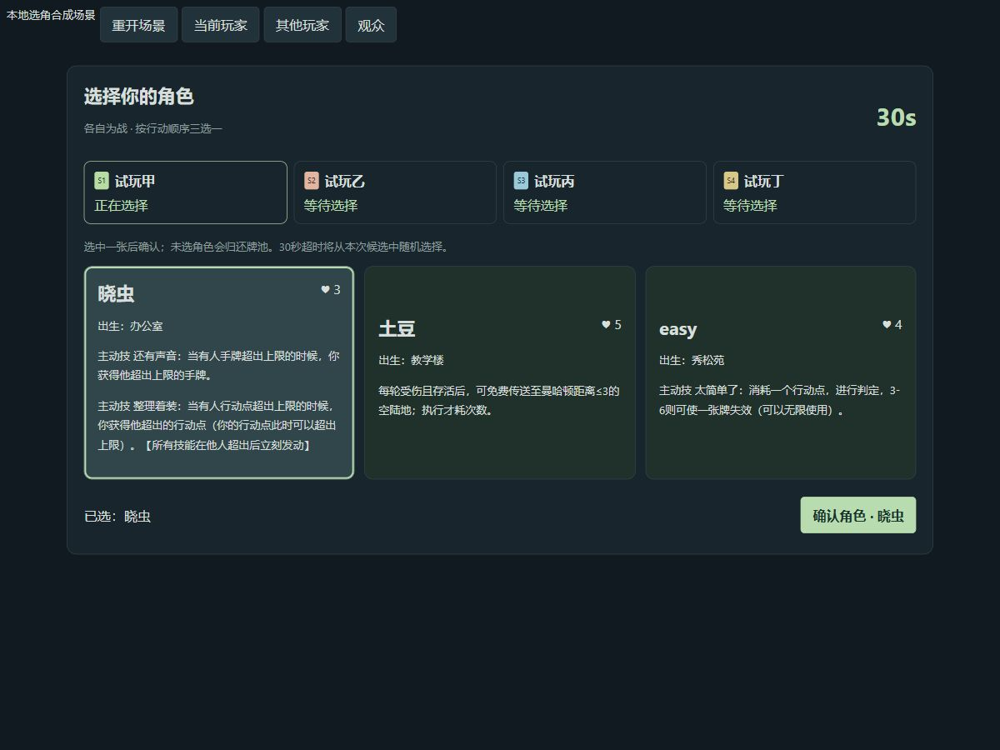
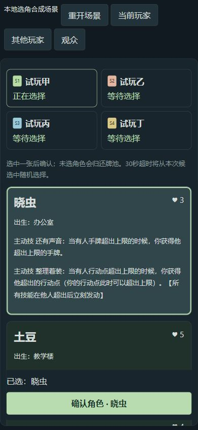

> 阶段状态更新（2026-10-19）：负责人已确认上线与真人验收，P2正式完成。当前结论见[P2结项记录](p2-closeout.md)，后续见[P3交接](p3-handoff.md)。以下正文保留该批次当时的版本、待部署及待验收状态；其中旧的未结项结论已由本次确认替代，未实施功能仍以[P3待办](p3-backlog.md)为准。

# 阶段三完整本地验证（2026-10-18）

版本0.2.4-p2.5 / web-v0.1.6 / schema2 / engineRevision16。16角色、23种85实体、39份参考素材，正式迁移016统一启用选角和完整技能；旧局按保存版本继续。以下为本地自动化和合成界面证据，云端迁移、线上部署、真人游玩及GitHub推送未执行。

## 已完成验证

- 全量44文件362项通过，原始结果见[自动化报告](../artifacts/p2-stage3/test-results.json)。涵盖旧版回归、新牌实体守恒、全部角色资源与免疫边界、反制栈、技能、装备失去／替换、复活费用锁定、组合和完整TS／SQL逐命令对照。
- 正式016可在012→014→015且未装013的数据库升级，事务注入失败完整回滚；重复执行保持旧profile、房间、凭证、回执和已有选角。001—005规则版本旧局时钟追赶与TS一致。012和013已交付SQL文件字节哈希保持不变。
- 真实公共RPC和Socket.IO本机四客户端完成选角，观众只读、候选／手牌隐私、乱序和重复请求、连接epoch接管、长轮询／WebSocket及网关重启恢复通过。独立Node进程重新打开持久化库并追赶原期限通过。
- 生产构建和类型检查通过；verify:catalog、verify:data、verify:classic-map、verify:db-data通过。187张原图及4份原始卡牌文档SHA256不变，39份浏览器参考按稳定ID生成。
- 浏览器本机合成场景：360×800、390×844、1200×850，页面无横向溢出、手牌高度等于内容高度、滚动条隐藏。完成选角、装备替换先失去后装配、西帝汶带人、复活先报价再支付、牢大出牌前方向选择与反应后重选；页面控制台无warn／error。详见[界面记录](../artifacts/p2-stage3/browser/validation.json)。

浏览器交互夹具为便于慢速操作，仅将选择窗口临时延长；正式10／20／30／60秒由TS／SQL测试验证，不将截图中的夹具倒计时作为线上配置。独立解压包安装／构建／完整回归、实际交付SQL及生产入口检查结果最终写入部署目录PACKAGE-VALIDATION.json，不能用工作区报告代替包的验证。

## 实现入口

- game-data/stage3.ts及versions.ts：生效规则、版本数据和16角色85实体。
- game-core/stage3-resources.ts、stage3-roles.ts、stage3-card-stack.ts、stage3-engine.ts及index.ts：资源、技能、嵌套反制、位移／结算、旧版本分派。
- 数据库015资源、016完整引擎／房间迁移；tools/generate-stage3-*.mjs保证生成文件一致。公开接口仍是原五个RPC，内部函数不对anon／authenticated开放。
- DraftBoard、Stage3Controls、Stage3Status、Stage3Rules、OnlineBoard／SpectatorBoard及协议：完整操作、观战、费用／方向预览与状态展示。

不包含阶段四剩余牌和3—6人设计。WorkBuddy交付见[p2-stage3-workbuddy.md](p2-stage3-workbuddy.md)。

---

# 以下为阶段三早期历史快照，已被上方完工状态取代

# 阶段三进展：选角基础已验证，角色接入待裁定

后续更新：负责人已批准完整角色方案及分池，梅梅涛追加最高优先级，见[p2-stage3-decisions.md](p2-stage3-decisions.md)。下文保留当时选角基础验证快照；当前另行开发v0.1.5反馈补丁，不代表本报告已验证完整16角色。
日期：2026-10-17，Asia/Hong_Kong。负责人要求开始阶段三，并已确认选中角色移出池、全桌不重复、未选归还、已选公开，以及2v2按机械猴子／帝汶家族分池。

**阶段三尚未完成。** 本次完成独立选角基础及界面组件；实际阵营名单／中立分配和新角色技能边界仍待负责人补充。正式房间没有开放选角，12个新角色没有作为无效果占位进入可玩池。活动候选仍0.2.2-p2.3 / web-v0.1.4 / schema2 / engineRevision12；尚未推送或部署。

## 已实现

- `packages/game-core/src/draft.ts`：独立DraftState，四座行动顺序、三张不同候选、30秒期限、已选角色、池、随机状态和请求回执。选角不创建可行动GameState，也不提前出生／发牌。
- 每次只移除选中的角色，未选两张保留可供后人抽取；即使中立角色同时被分入两边，选中后也从所有池移出，保证全桌唯一。
- 阵营池必须显式配置，不从名字／水生类别推断。开始前检查候选容量，包括池之间的重叠；不足时在消耗随机数前拒绝，避免后续玩家无三张可选。测试中的分池是合成配置，不是正式家族归属表。
- 原期限和候选保存在状态中；读取视图不重抽、不续期。超时由权威随机从当次三张选一，离线时间跨过多个窗口时按测试起始时钟为1秒时的31／61／91／121秒等原始期限追赶，不在恢复时重新开始四个30秒窗口。
- 重复同一请求返回当前状态且不重复执行；同一ID改内容、过期revision／窗口、错误座位、非候选角色及状态／随机注入均拒绝，失败保留原状态。
- `draftView`仅本人／鉴权观众可见当前候选，所有玩家可见已选角色；不返回池、随机源和回执。观众身份必须由未来房间鉴权层传入，客户端不能自称观众绕过检查。
- `database/engine/draft.sql`与生成的`013_draft_foundation.sql`实现相同私有SQL状态机。013仅添加内部函数，原四个profile、现有房间、凭据、回执、活动health和公开RPC保持原样；012字节哈希未变。
- `DraftBoard.tsx`支持三选一、先选后确认、当前选角者、30秒显示、公开进度、等待和观战；旧4角色显示已有网页版能力，其他角色仅在合成组件中展示原始资料。`draft-protocol.ts`单独定义严格的选择意图，不含actor、随机源、池或期限。

## 尚未接通的部分

当前`main.tsx`、活动房间RPC及Gateway没有开放新选角命令；活动`commandSchema`继续拒绝draft-pick。DraftState尚未保存到真实房间，不把读取同一状态的测试称为已完成真实断网重连。选角结束后还没有接通新的16角色GameState初始化、出生／发牌和完整技能。

完整接入要等待[裁定清单](p2-stage3-decisions.md)中的实际分池和新技能执行参数；东帝汶／应豪组合胜利、谢bro猴子游戏、涨佳选装备等还依赖阶段四。不会删掉依赖技能，或用只有名字的角色冒充完成。本轮未修改原始牌面资料，不推翻已有4角色网页裁定。

## 实际验证

- 全量 **32个测试文件、271项通过、0失败**，其中17项为新增选角专项；报告`artifacts/p2-stage3/test-results.json`，摘要及013 SHA-256见`artifacts/p2-stage3/summary.json`。
- FFA／合成家族分池共48组种子开局及后续逐命令TS／SQL完整状态一致。覆盖不重复、未选归还、共享候选从两边移除、候选容量、隐私、30秒边界、离线超时追赶、重复／过期／非法请求。
- 013在单条DO内故意失败完整回滚，重复执行不改四个profile或房间行；原创建回执和凭据可用；匿名及authenticated不能直接调用私有选角函数。活动health仍v0.1.4／引擎12。
- UI静态渲染验证本人／他人／观战权限、过期／等待确认禁用、旧角色有效说明，以及选择意图的严格字段限制。
- 本地浏览器使用真实DraftBoard和参考状态机的合成页面，不连接云数据库。已操作选择→确认→下一人，切换他人后候选隐藏，观众可看三张但不能操作；360／390／1200宽检查通过，控制台无警告或错误。
- 360px下页面宽360，无横向溢出；选角容器可竖向滚动，clientHeight676／scrollHeight992，三张候选各自clientHeight与scrollHeight一致（180／190／250），没有卡片内部截字；页面与容器原生滚动条均隐藏。390px和1200px截图见下方。
- 构建、类型检查、版本目录／数据库数据／经典CSV校验及187图片／4份原始牌面文档SHA-256检查通过。旧局、既有联机、聊天和观战回归继续通过，但不代表未接入的选角网络流程已通过。

开发中修复了SQL保留字参数／变量名导致的初始编译错误，并将UI测试改为既有测试配置可发现的.test.ts；最终报告包含全部17项。以上是本地开发验证，未操作GitHub Issue裁定、源码推送、WorkBuddy数据库或线上服务。
